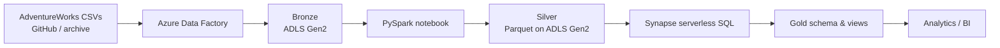

# AdventureWorks Lakehouse | Azure Data Engineering

<p align="center">
  <strong>End-to-end batch data engineering with Azure Data Factory, ADLS Gen2, PySpark, and Synapse SQL</strong>
</p>

<p align="center">
  
  
  
  
  
</p>

An implementation-focused portfolio project that takes AdventureWorks sample data through a cloud data pipeline: source ingestion, lake storage, Spark transformations, and SQL-based analytical access. The repository includes Azure Data Factory JSON exports, a PySpark notebook, SQL scripts, sample CSV inputs, and reusable data-quality helpers.

> **Project status:** Learning/portfolio implementation. The pipeline definitions and scripts are provided as deployable starting points; Azure resources, permissions, paths, and credentials must be configured for your own subscription before execution.

## At a glance

| Layer | Service / technology | Responsibility |
|---|---|---|
| Source | AdventureWorks CSV files | Sample business data |
| Ingestion | Azure Data Factory | HTTP copy and metadata-driven ingestion |
| Bronze | Azure Data Lake Storage Gen2 | Landing area for raw files |
| Silver | PySpark / Apache Spark | Data preparation and Parquet output |
| Gold | Synapse serverless SQL | Views and external-table example |
| Quality | PySpark helper | Required-column, null, and duplicate-key checks |

## Architecture



### Pipeline patterns

- **GitToRaw:** a straightforward HTTP-to-lake copy pipeline.
- **DynamicGitToRaw:** a Lookup + ForEach pattern that reads file metadata and passes source/destination parameters to reusable datasets.

### Transformation examples

The Silver notebook reads the AdventureWorks entities from Bronze, applies column-level preparation (for example date attributes, customer full name, product fields, and sales transformations), and writes Parquet datasets to Silver.

### Gold analytics

The SQL assets create a `gold` schema, expose Silver Parquet folders through `OPENROWSET` views, and demonstrate a managed-identity credential, external data sources, Parquet file format, and an external table.

## Repository map

```text
.
├── archive/                  # AdventureWorks source CSV files
├── credential/               # Workspace managed-identity definition
├── dataset/                  # ADF source, parameter, and sink datasets
├── docs/
│   └── ARCHITECTURE.md        # Data flow and engineering notes
├── factory/                  # ADF factory export
├── integrationRuntime/       # Integration runtime definition
├── linkedService/             # HTTP and ADLS linked services
├── notebooks/
│   └── data_quality_checks.py # Reusable PySpark quality checks
├── pipeline/                 # Static and metadata-driven pipelines
├── sqlscript/                # Schema, views, external table, sample queries
├── Silver_layer.ipynb         # Silver-layer PySpark notebook
└── publish_config.json       # ADF publish configuration
```

## Getting started

### 1. Prerequisites

- An Azure subscription with permission to create or use Azure Data Factory, ADLS Gen2, and a Spark/Synapse environment.
- An ADLS Gen2 account with the required landing and curated containers (for example `bronze` and `silver`).
- Git and a Spark environment capable of running the notebook.
- A serverless SQL endpoint if you want to run the Gold-layer scripts.

### 2. Clone

```bash
git clone https://github.com/subhashre-m/AdventureWorkLoad_Project.git
cd AdventureWorkLoad_Project
```

### 3. Configure your Azure environment

Before deployment, review and update the environment-specific values in:

- `linkedService/StorageDataLake.json`
- `linkedService/awproject-rgsynapse-WorkspaceDefaultStorage.json`
- `linkedService/awproject-rgsynapse-WorkspaceDefaultSqlServer.json`
- `Silver_layer.ipynb`
- `sqlscript/Create Views Gold.json`
- `sqlscript/External Table.json`

Replace storage account names, workspace names, database names, container paths, and source locations with values from your environment. Configure authentication with managed identity and grant the relevant identities only the required data-plane and SQL permissions. Do not commit secrets.

### 4. Deploy and run in sequence

1. Import or recreate the Data Factory resources from the JSON definitions.
2. Configure linked services, datasets, and the parameter metadata file expected by `ds_git_parameter`.
3. Run `GitToRaw` or configure and run `DynamicGitToRaw` to land source files in Bronze.
4. Attach `Silver_layer.ipynb` to your Spark environment, update its paths, and run the transformations.
5. Execute the Gold SQL scripts in order: create schema, create views, then (if required) external data source/table setup.
6. Run the sample analytics queries after the Gold views are available.

## Data quality

`notebooks/data_quality_checks.py` provides reusable checks for:

- Required-column and primary-key column presence
- Null counts across configured columns
- Duplicate counts for configured business keys
- A simple per-table pass/fail report

Example:

```python
from notebooks.data_quality_checks import run_table_checks, print_quality_report

result = run_table_checks(
    silver_df,
    table_name="AdventureWorks_Sales",
    primary_key_columns=["<confirmed_business_key>"],
    required_columns=["OrderDate", "OrderNumber", "OrderQuantity"],
)
print_quality_report([result])
```

Replace the placeholder with a key confirmed from the source model; do not assume a business key without validating it. Call `assert_quality_passed([result])` after collecting checks to stop downstream processing when a check fails.

## Important engineering notes

- **Silver reruns:** the notebook now defaults to `overwrite` for full-refresh idempotency. Each run replaces the corresponding Silver output path. Choose the `append` widget option only for intentionally non-overlapping batches; it can reintroduce duplicates.
- **Environment coupling:** resource names and storage paths are examples from one Azure setup, not portable defaults.
- **Dynamic ingestion:** the metadata-driven pipeline expects a JSON metadata file in the configured parameter location. Populate it with valid relative source URLs, target folders, and file names.
- **Security:** the storage linked service is configured for system-assigned managed identity. Ensure the identity exists in the deployed service and has appropriate access. Review old Git history if any credential was previously committed; changing the latest file does not erase historical exposure.
- **Validation:** exported JSON files are configuration artifacts. Validate them in your target Azure workspace before running workloads.

## Roadmap

- [ ] Parameterize environment-specific resource names and paths.
- [x] Make Silver full-refresh writes idempotent by default (overwrite mode); append is an explicit opt-in.
- [ ] Add validated incremental-load support after confirming source watermarks/business keys.
- [ ] Add pipeline-level logging, failure handling, and run audit records.
- [ ] Add schema-drift and referential-integrity checks.
- [ ] Add a Gold reporting layer or Power BI dashboard.
- [ ] Add automated validation for JSON definitions and Python helpers.

## Source data and attribution

This project uses the AdventureWorks sample dataset for learning and demonstration. Retain applicable dataset and upstream project attribution and comply with the license/terms of any source material you reuse. The repository documents and configuration should not be interpreted as a claim of exclusive ownership over the underlying sample data or upstream concepts.

## Maintainer

**Subhashree** · [@subhashre-m](https://github.com/subhashre-m)

Contributions, bug reports, and suggestions are welcome via GitHub Issues.

## Useful links

- [Architecture and engineering notes](docs/ARCHITECTURE.md)
- [Sample Gold SQL queries](sqlscript/Sample%20Analytics%20Queries.sql)
- [Azure Data Factory documentation](https://learn.microsoft.com/azure/data-factory/)
- [Azure Data Lake Storage Gen2 documentation](https://learn.microsoft.com/azure/storage/blobs/data-lake-storage-introduction)
- [Azure Synapse Analytics documentation](https://learn.microsoft.com/azure/synapse-analytics/)

---
<p align="center"><sub>Built as a practical Azure data engineering learning project.</sub></p>
