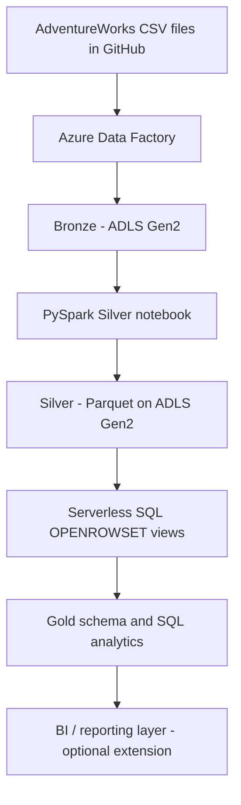

# Architecture and Engineering Notes

## Data flow

## Ingestion patterns

- **Static copy:** the `GitToRaw` pipeline copies a configured HTTP CSV source into Bronze.
- **Metadata-driven copy:** `DynamicGitToRaw` reads file metadata with Lookup, iterates with ForEach, and passes source and sink parameters to datasets.

## Transformation layer

The Silver notebook reads CSV datasets from Bronze, applies column-level transformations, and writes Parquet files. Review the notebook's append behavior before reruns: repeated executions can add duplicate records unless the target is cleared or the load is made idempotent.

## Data quality gate

The helper in `notebooks/data_quality_checks.py` provides:
- Required-column and key-column existence checks
- Null counts for configured required/key columns
- Duplicate counts for configured business keys
- A simple pass/fail result per dataset

Configure real business keys from the source schema; do not treat guessed keys as authoritative.

## Incremental-load design recommendation

The current notebook uses append writes. A production-ready extension should:
1. Identify a reliable watermark (for example, a source update timestamp) or a deterministic business key.
2. Persist the last successful watermark in a control/audit table.
3. Read only new or changed source records.
4. Deduplicate the incoming batch using the confirmed business key.
5. Merge into Delta targets where supported, or write partitioned Parquet through a controlled staging-and-replacement process.
6. Record run ID, start/end time, source and target row counts, watermark, and status.
7. Make retries safe so a rerun does not duplicate data.

The available source files and notebook do not establish a trustworthy change-tracking column for every entity. Therefore this repository documents the incremental pattern rather than pretending a complete CDC implementation is already configured.
