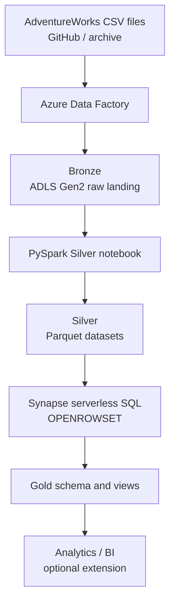

# Architecture and Engineering Notes

## End-to-end data flow

## Components

| Component | Current implementation | Configuration to verify |
|---|---|---|
| Source | AdventureWorks CSV files in `archive/` and HTTP source definitions | Source URLs and file availability |
| Ingestion | `GitToRaw` and `DynamicGitToRaw` ADF pipelines | Dataset parameters, metadata JSON, target paths |
| Bronze | ADLS Gen2 landing folders | Container names and ADF/Spark permissions |
| Silver | `Silver_layer.ipynb` with PySpark transformations | Storage account, folder paths, schema assumptions |
| Gold | SQL schema, `OPENROWSET` views, external-table example | SQL endpoint, storage URL, credential and permissions |
| Quality | `notebooks/data_quality_checks.py` | Confirmed business keys and required columns |

## Ingestion patterns

- **Static copy:** `GitToRaw` uses an HTTP source and a configured sink dataset to copy a CSV input into the lake.
- **Metadata-driven copy:** `DynamicGitToRaw` uses Lookup to read metadata, then ForEach to pass each source URL and destination details into parameterized datasets.
- The metadata dataset points to a JSON file named `git.json` in the configured `parameter` file system. Ensure that file exists and conforms to the dataset schema before running the dynamic pipeline.

## Transformation layer

The Silver notebook reads the Bronze CSV entities, applies transformations, and writes Parquet outputs. Examples include calendar month/year derivation, customer full-name construction, product field preparation, and sales data preparation.

**Rerun behavior:** the notebook now exposes a `silver_write_mode` widget and defaults to `overwrite`, making full-refresh runs repeatable without accumulating prior output. Overwrite replaces each target folder, so select `append` only for deliberately non-overlapping batches. This is not incremental/CDC processing.

## Gold SQL layer

The SQL assets demonstrate:

1. Creating the `gold` schema.
2. Creating views over Silver Parquet folders with `OPENROWSET`.
3. Creating a managed-identity database-scoped credential and external data sources.
4. Defining a Parquet external file format and an example external table.

The storage URLs and database/workspace names are environment-specific. Confirm the serverless SQL feature set and authentication requirements in the target workspace before deployment.

## Data quality gate

The helper in `notebooks/data_quality_checks.py` provides:

- Required-column and key-column existence checks
- Null counts for configured required/key columns
- Duplicate counts for configured business keys
- A simple pass/fail result per dataset

Configure real business keys from the source schema; do not treat guessed keys as authoritative.

## Quality-gate usage

After running the configured checks, call `assert_quality_passed(results)` before publishing or querying the Silver outputs. The helper raises `ValueError` with failed-table details if any check fails. Business keys and required columns still need to be confirmed for each dataset.

## Incremental-load design recommendation

A production-ready extension should:

1. Identify a reliable watermark (for example, a source update timestamp) or deterministic business key.
2. Persist the last successful watermark in a control/audit table.
3. Read only new or changed source records.
4. Deduplicate the incoming batch using the confirmed business key.
5. Merge into Delta targets where supported, or write partitioned Parquet through a controlled staging-and-replacement process.
6. Record run ID, start/end time, source and target row counts, watermark, and status.
7. Make retries safe so a rerun does not duplicate data.

The supplied source files and notebook do not establish a trustworthy change-tracking column for every entity. Therefore, incremental processing is a design recommendation, not a claim that CDC is already implemented.

## Deployment and security checklist

- Replace sample storage account, workspace, database, and folder values.
- Configure managed identity on the deployed services and grant least-privilege access.
- Keep secrets out of source control; use a secure secret store when a secret is unavoidable.
- Verify the SQL identity can read the relevant lake paths.
- Review Git history if credentials were ever committed. Removing a credential from the latest revision does not remove it from older commits.
- Test each pipeline and SQL script in a non-production environment before scheduling workloads.
